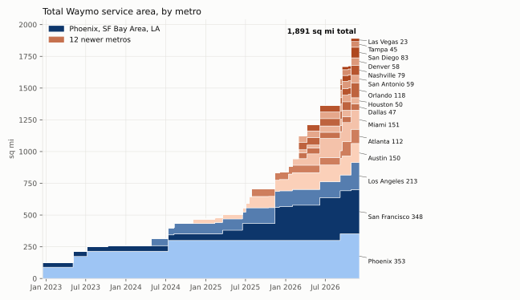
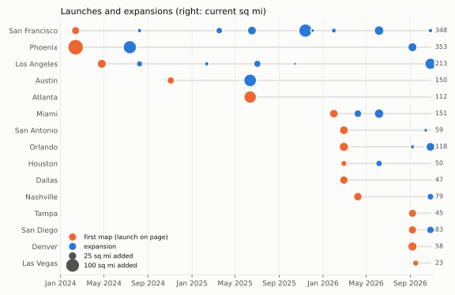
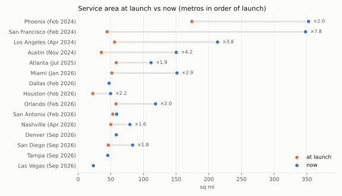
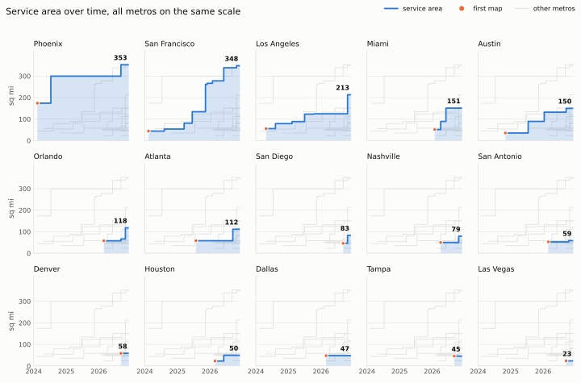
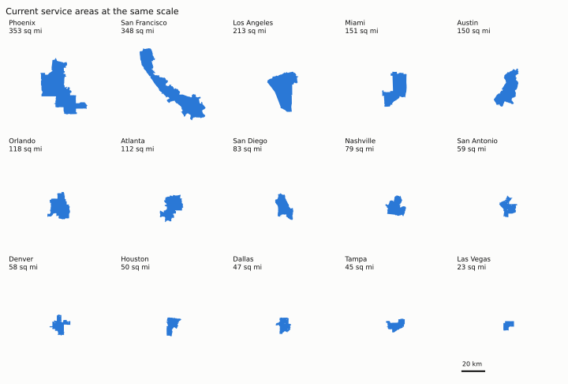
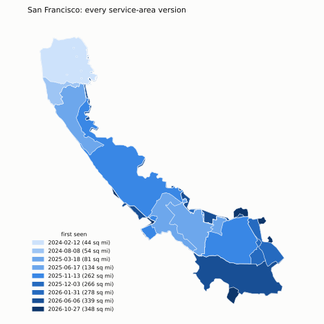
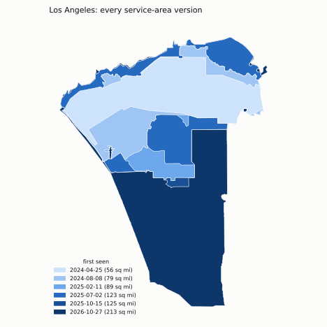

# Waymo service areas, Dec 2022 - Nov 2026

*Based on 49 service-area map versions traced from dated Waymo announcements and archived help pages
(see [README.md](README.md) for method and accuracy). All areas are as drawn by
Waymo, in square miles; figures and numbers come from [05_report_figures.py](05_report_figures.py).*

*Who lives inside these areas (2020 Census): see [report_population.md](report_population.md).*

## Key numbers

| | |
|---|---|
| Earliest data, December 16 2022 | **123 sq mi** (Phoenix, SF) |
| Total service area, Nov 4 2026 | **1,891 sq mi** across 15 metros |
| Growth since December 2022 | **×15.3** in 3.9 years, about ×2.0 per year (doubling every ~12 months) |
| Total at year end | 2022: 123 · 2023: 259 · 2024: 468 · 2025: 838 · 2026 (to date): 1,891 |
| First documented metro maps | 2022: 2 · 2024: 2 · 2025: 1 · 2026: 10 |
| Expansions of existing metros | 2023: 4 · 2024: 3 · 2025: 8 · 2026: 16 (median 146 days between expansions in a metro) |
| Area added by expansions | 1,179 sq mi, of which **16.9 sq mi** removed elsewhere (1.4%) |
| Share of Phoenix + SF + LA | 100% in early 2024 → **48%** now |

Early SF maps now reach December 2022; the [early-history report](report_early_history.md)
documents six announcement maps and the stale Phoenix map exclusion.
December 16, 2022 is the comparison baseline for both metros and is labelled
"Earliest data", not "Launch". The Phoenix full-area map is labelled December
2022; its exact baseline day is attributed to the dated December 16 announcement.

## Growth went from linear to compounding

Until mid-2025, growth came from expanding the three original markets. From mid-2025,
new cities and their expansions did most of the work: Austin grew in July 2025
and January 2026, Atlanta began with a smaller area, and ten new metros appeared
in 2026. The restored Austin/Atlanta maps and dates are documented in
[the history repair](report_history_repair.md). The newer metros now cover more area together (977 sq mi)
than Phoenix, SF and LA combined (914 sq mi).

## When each metro launched and grew

- **2026 is the year of new cities.** Miami, Dallas, Houston, Orlando and San Antonio
  appeared within four weeks (Jan 31 – Feb 28), Nashville in April, and Denver,
  San Diego, Tampa and Las Vegas in September.
- **Expansions are getting more frequent.** There were 16 so far in 2026, against 8 in all
  of 2025. The October 27 capture showed five metros with new maps (LA, SF, Orlando,
  Nashville, San Diego).
- Phoenix is the exception: its map stayed the same for over two years (Jul 2024 →
  Sep 2026), then grew 57 sq mi into Gilbert and Chandler.

## Launch small, then grow

New metros follow a template. The median launch size in 2026 was **49 sq mi**, and every
2026 launch was between 22 and 58 sq mi. Atlanta's first recovered map is 58 sq mi; its June 2025 launch announcement
described 65 sq mi. Our polygon records the area drawn on the recovered map. The first reconstructed Phoenix map (89 sq mi, December 2022) reflects an older,
already-mature market.

Metros then grow fast. SF grew **×10.2** (34 to 348 sq mi), Austin ×4.2, LA ×3.8 and
Miami ×2.9 in just four months.

On the same scale, the gap is clear: Phoenix and SF are now about 350 sq mi each, LA
213, and Miami and Austin about 150. Six of the ten 2026 launches are still under
60 sq mi. Five metros still carry the label "Gradually adding riders" (Dallas, Denver, Houston, Las Vegas, Tampa: 224 sq mi, 12% of the total).

## Biggest single expansions

| Date observed or announced | Metro | Before to after (sq mi) | Added |
|---|---|---|---|
| 2025-11-13 | San Francisco | 134 to 262 | +127 |
| 2026-10-27 | Los Angeles | 124 to 213 | +89 |
| 2023-05-04 | Phoenix | 89 to 174 | +86 |
| 2024-07-12 | Phoenix | 215 to 300 | +85 |
| 2026-06-06 | San Francisco | 278 to 339 | +63 |
| 2026-06-06 | Miami | 89 to 151 | +62 |
| 2026-09-07 | Phoenix | 300 to 353 | +57 |
| 2025-07-17 | Austin | 36 to 89 | +54 |

**Service areas almost never shrink.** Across 31 expansions, only 16.9 sq mi
disappeared from earlier maps, against 1,179 sq mi added. The largest removal is
3.7 sq mi (Phoenix, Sep 2026). Some of that removed area is probably just tracing
error between map versions rather than a real cutback.

## Shape and scale

- **SF Bay Area** is an 83 km corridor from the Golden Gate to Campbell and is the least
  compact area (Polsby-Popper 0.16; a circle is 1.0). It's shaped by the Peninsula
  between the ocean and the bay.
- **Phoenix** (353 sq mi) is the largest area, a grid-aligned block 54 km tall.
- **Las Vegas** is the smallest (23 sq mi) and most compact (0.52): one rectangle around
  the Strip and downtown.
- Most 2026 launches fit in a 15–25 km box.

## How SF and LA grew

Each panel is one version of the map: orange is new in that version, blue was already
served. All panels for a metro share the same extent. Basemap: Esri World Light Gray Canvas.

San Francisco now has eleven documented states: the partial public area
(December 2022), expansion in February 2023, the full city (October 2023) → Daly City (Aug 2024) →
a separate Silicon Valley zone (Mar 2025) → SF down to Burlingame (Jun 2025) → the
full Peninsula linking both (Nov 2025) → San José and Campbell (2026).

Los Angeles started as a Santa Monica–DTLA strip, then filled in toward the airport
and Inglewood. The latest map (Oct 27 2026) adds the South Bay down to Torrance.

## Caveats

- Dates normally record the first verified map observation; early SF/Phoenix and
  two Austin dates use dated operator announcements. `date_basis`, `date_source_url`, and
  `change_window_start` retain that distinction. An observed change is bounded by
  the last observation of the old city map and the first observation of the new one. For metros
  that were already running when the archive starts (Phoenix, SF), "launch" means
  "Earliest data", not a service launch.
- The provenance work covers Austin/Atlanta and the early SF/Phoenix extension.
  Other history retains the earlier reconstruction pending a separate audit.
- Areas are as drawn, including water inside the blue fill (Biscayne Bay, Mission Bay).
  Boundaries are accurate to roughly 50–300 m, so differences under ~2 sq mi between
  versions aren't meaningful.
- The page shows public rider service areas. It doesn't show testing areas, airport
  access or freeway-only extensions.

Data: [waymo_service_areas.gpkg](waymo_service_areas.gpkg) ·
[data/area_timeseries.csv](data/area_timeseries.csv) ·
[data/expansion_events.csv](data/expansion_events.csv) ·
[data/report_stats.json](data/report_stats.json)
