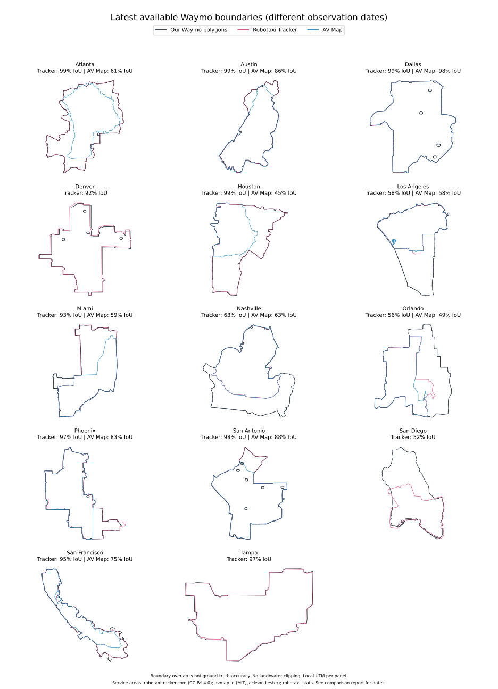
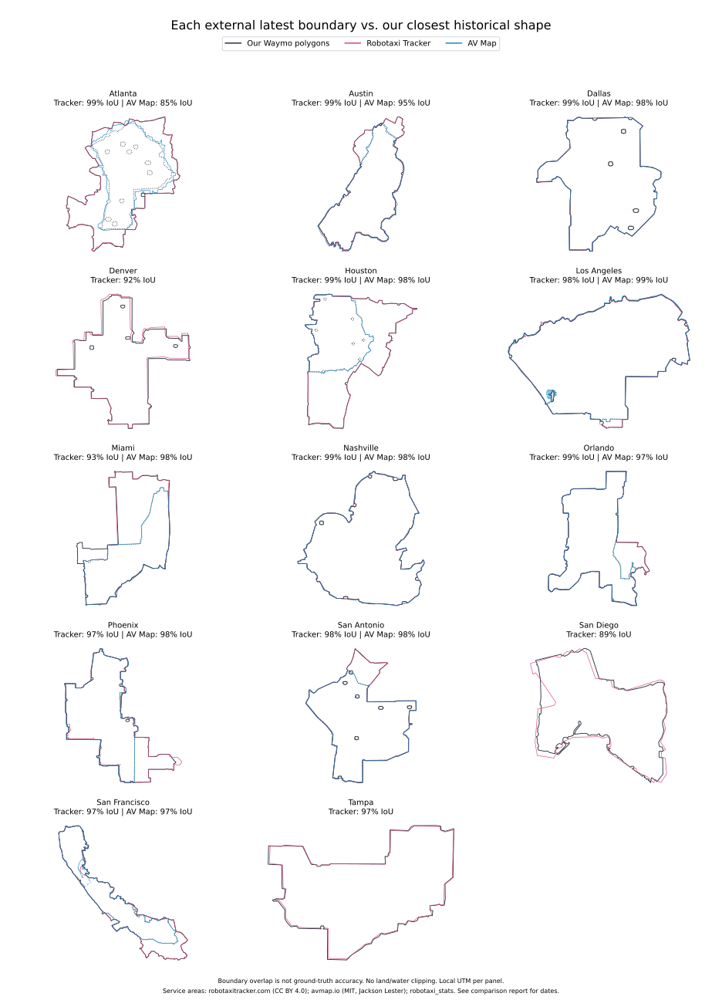

# Waymo boundaries compared with public robotaxi datasets

Updated 2026-11-04 after the [Austin/Atlanta history repair](report_history_repair.md).
Latest polygons generally agree; historical dates and source scope require their own checks.
An approximately 98% median best-match IoU is agreement between digitizations, not ground-truth validation.

## Pinned public inputs

- Our GeoPackage: 45 city/map versions, 42 metropolitan versions, 15 metros. SHA-256 is in the [manifest](data/external_comparison/manifest.json).
- [Robotaxi Tracker](https://github.com/Robotaxi-Tracker/robotaxi-service-areas/tree/3857624ca629688cbfbedde1b75d2ece7c2af0f6): revision `3857624`, committed 2026-09-10.
- [AV Map](https://github.com/path-avmap/av-map-data/tree/3c94c4f924c69f425a54debe0c594a286bf16d8c): revision `3c94c4f`, committed 2026-05-15.

The comparison uses public repository files, which can differ from their live websites.
Robotaxi Tracker has 14 latest Waymo polygons without per-polygon observation dates.
AV Map has 26 geometry events combined into 25 metropolitan states across 11 metros.
Its San Francisco and Silicon Valley components are unioned to match our metro definition.

Service areas: [Robotaxi Tracker](https://robotaxitracker.com/), copyright 2026 Ethan McKanna, CC BY 4.0;
[AV Map](https://avmap.io/), copyright 2025 Jackson Lester, MIT.
Original license texts are retained in the comparison data folder. Geometry repair, metro unions and rendering are the transformations used here.

## Shape agreement

Each source's latest polygon is matched to our most similar historical version.
This deliberately favors spatial agreement and does not confirm that the dates match.

| Dataset | Matched metros | Median IoU | Metros with IoU >=95% | Median absolute area difference |
|---|---:|---:|---:|---:|
| Robotaxi Tracker | 14 | 97.99% | 11 | 0.79% |
| AV Map | 11 | 97.96% | 9 | 0.88% |

Tracker's LA, Nashville, Orlando and San Diego polygons match older coverage.
For LA, overlap rises from 58.28% against our latest polygon to 98.25% against the older shape.
After historical matching, Tracker's Denver, Miami and San Diego still have 92.41%, 92.58% and 88.60% IoU.
AV Map's Atlanta polygon now matches our recovered smaller map at 85.10% IoU; its January Austin polygon matches at 94.83%.
Those remaining discrepancies are retained rather than resolved by importing a larger polygon.





Black solid is our best historical match for Tracker; black dotted is our match for AV Map, which may be a different version.

## Latest available areas

All areas are recomputed on the WGS84 ellipsoid, with no extra land/water clipping.
These values compare different source dates and must not be read as simultaneous operational areas.

| Metro | Ours (sq mi) | Tracker | AV Map |
|---|---:|---:|---:|
| Atlanta | 111.56 | 111.64 | 68.55 |
| Austin | 150.13 | 151.16 | 138.92 |
| Dallas | 47.42 | 47.80 | 47.84 |
| Denver | 58.41 | 59.37 | n/a |
| Houston | 49.59 | 49.10 | 22.64 |
| Las Vegas | 23.35 | n/a | n/a |
| Los Angeles | 213.33 | 124.64 | 124.06 |
| Miami | 151.17 | 144.71 | 90.86 |
| Nashville | 79.23 | 50.20 | 50.53 |
| Orlando | 118.36 | 66.00 | 57.95 |
| Phoenix | 352.63 | 355.38 | 302.95 |
| San Antonio | 58.84 | 59.25 | 53.52 |
| San Diego | 83.31 | 47.23 | n/a |
| San Francisco | 347.91 | 335.41 | 264.13 |
| Tampa | 45.37 | 44.17 | n/a |

## Date and provenance findings

- The live-under-historical-cache defect has been fixed for Austin/Atlanta. The recovered raw captures, hashes and two corroborated operator dates are described in [the repair report](report_history_repair.md). Other metros retain legacy provenance pending audit.
- The original incorrect cache bytes are retained in `raw/snapshots_legacy/`; [provenance_audit.json](data/external_comparison/provenance_audit.json) preserves the before-repair hashes and replay evidence.
- AV Map's LA polygon labelled 2024-08-06 measures 89.07 sq mi and matches our February 2025 shape. [Waymo's contemporary announcement](https://waymo.com/blog/2024/08/expanding-destinations-for-san-francisco-and-los-angeles-riders/) instead specifies 79 sq mi. That pairing remains unimported.
- AV Map's January 2026 Miami polygon best matches our April map. That date/shape disagreement remains unresolved.
- Tracker's Bay Area and Miami properties identify `waymo_android_app_get_account_status` as their source. Treat their disagreement with help maps as a possible timing, scope or eligibility difference; original app captures/dates still need verification. Other inspected Tracker files have less explicit provenance.

## Reproduce and inspect

```bash
python areas/waymo/compare_external.py --fetch
python areas/waymo/compare_external.py
```

`--fetch` restores the tracked pinned inputs when local raw data is missing. `--refresh` intentionally changes the upstream baseline.
Downloads remain under gitignored `raw/external_comparison/`; the manifest hashes every source file and our GeoPackage.

- [Latest pairs](data/external_comparison/latest.csv).
- [All best historical pairs](data/external_comparison/best_historical_match.csv) and [one per external latest polygon](data/external_comparison/best_historical_latest.csv).
- [Pairs using our recorded validity at the external event date](data/external_comparison/at_external_date.csv): 11 comparable events; dates before our first record in a metro are omitted.
- [Summary](data/external_comparison/summary.json) and [manifest](data/external_comparison/manifest.json).

No access/status filter is applied to the polygons. Date uncertainty, invitation-only access and the inherited gaps must be considered separately from overlap metrics.
