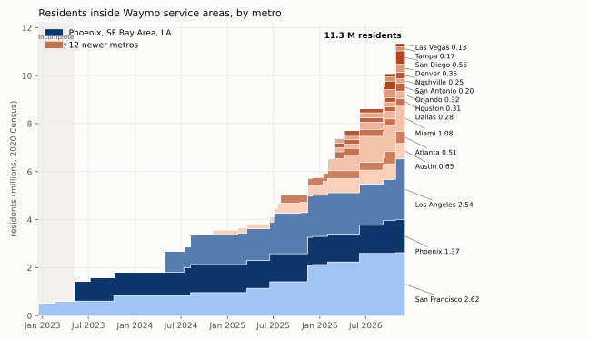
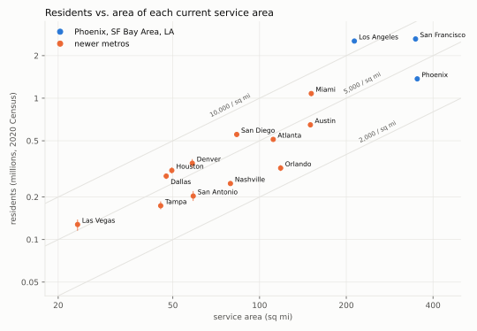
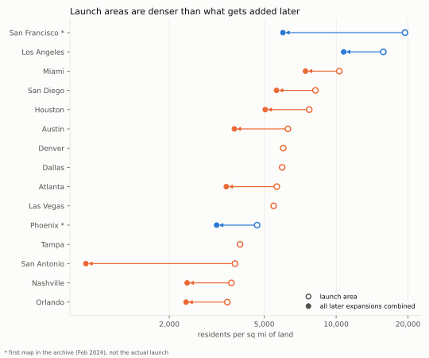
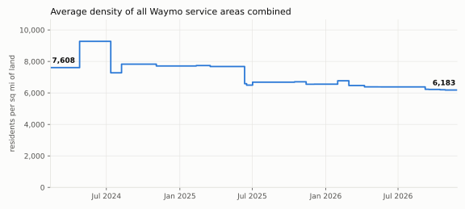
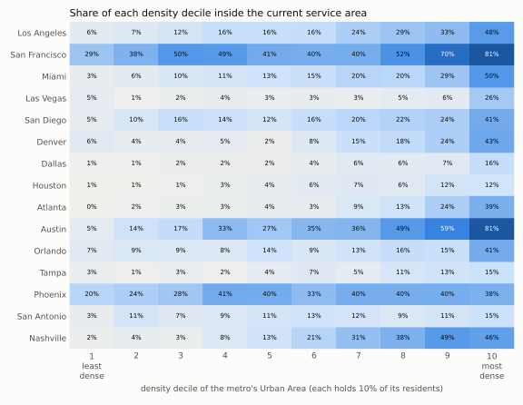

# Who lives inside Waymo's service areas?

*Residents inside each service-area version, from 2020 Census blocks. Companion to
[report.md](report.md). Numbers and figures come from [06_population.py](06_population.py);
method and caveats are at the end.*

## Key numbers

| | |
|---|---|
| Residents inside a service area, Feb 2024 | **1.65 million** (Phoenix, SF) |
| Residents inside a service area, Nov 4 2026 | **11.3 million** (11.0–11.6 M with ±150 m boundary error), 5.2 M housing units |
| Growth | ×6.9 in 2.7 years; **×2.2 in the last 12 months** (5.05 M → 11.3 M) |
| At year end | 2024: 3.6 M · 2025: 5.8 M · 2026 (to date): 11.3 M |
| Share living in Phoenix + SF + LA | **58%** (vs. 48% of the area) |
| Average density | 6,200 residents per sq mi of land (7,700 at the end of 2024) |
| Metros where the launch area was denser than later expansions | **11 of 11** |

Residents grew a bit slower than area (×6.9 vs ×8.7), because the newer land is
less dense. The ten 2026 launches cover 715 sq mi but only 3.6 M residents.

## Residents served over time

San Francisco (2.6 M) and Los Angeles (2.5 M) each have almost twice Phoenix's residents
(1.4 M) on less or similar area. The Oct 27 2026 LA expansion to Torrance added
**828,000 residents**, the largest addition by any expansion. Only the original SF and
LA launch areas (each ~840–880k) were larger.

## Residents vs. area

The diagonal lines are constant density (drawn area, including water). Three groups:

- **Dense cores, 7,500–12,000 per sq mi of land:** LA (12,100), Miami (8,600) and SF
  (7,700). SF's average is diluted by the Peninsula suburbs; the city itself is ~19,000.
- **The 2026 template, 5,500–7,000 per sq mi:** Houston, Dallas, Denver, San Diego, Las Vegas.
  Small (23–83 sq mi) launch areas around downtown and the nearest dense neighbourhoods.
- **Sprawl, 2,900–4,600 per sq mi:** Phoenix, Austin, Atlanta, Nashville, San Antonio,
  Tampa, Orlando. Phoenix has the most area of any metro (353 sq mi) but only
  half of SF's residents.

## Start dense, then spread out

In every metro that has expanded, the land added later is less dense than the launch area.
SF's first map (the city, 19,400 per sq mi) is three times as dense as everything added since
(6,000). In the other metros, later land is 28–40% less dense. San
Antonio's drop looks dramatic but rests on a single 6 sq mi expansion with 5,600 residents.

This is the "dense core first" pattern you'd expect: launch where trip demand per square
mile is highest, then extend to suburbs, airports and corridors.

Combined over all metros, average density fell from about 7,600 to 6,200 residents per sq mi
of land:

The early peak (9,300) is LA's dense launch (Apr 2024). The large drops come from
low-density additions: Phoenix's expansion (Jul 2024), Austin's July 2025 expansion
and Atlanta's first recovered map (Jul 2025). Since then, 2026's mix of new metros and suburban expansions has
lowered the average slowly.

## How much of each metro is covered?

Share of each metro's 2020 Census Urban Area population that lives inside today's
service area:

| Metro | Residents served | Urban Area pop. | Share | Densest 20% covered |
|---|---|---|---|---|
| San Francisco | 2.62 M | 5.35 M (SF–Oakland + San José) | **49%** | 76% |
| Austin | 0.65 M | 1.81 M | 36% | 70% |
| Phoenix | 1.37 M | 3.98 M | 34% | 39% |
| Nashville | 0.25 M | 1.16 M | 22% | 47% |
| Los Angeles | 2.54 M | 12.24 M | 21% | 41% |
| San Diego | 0.55 M | 3.07 M | 18% | 33% |
| Miami | 1.08 M | 6.08 M | 18% | 39% |
| Orlando | 0.32 M | 2.27 M (incl. Kissimmee) | 14% | 28% |
| Denver | 0.35 M | 2.69 M | 13% | 33% |
| San Antonio | 0.20 M | 1.99 M | 10% | 13% |
| Atlanta | 0.51 M | 5.10 M | 10% | 31% |
| Tampa | 0.17 M | 2.78 M | 6% | 14% |
| Las Vegas | 0.13 M | 2.20 M | 6% | 16% |
| Houston | 0.31 M | 5.85 M | 5% | 12% |
| Dallas | 0.28 M | 5.73 M | 5% | 12% |

**SF is the only metro where Waymo reaches about half the urban population.** The 2026
launches mostly cover 5–15%. Dallas and Houston, two of the largest urban areas, are at 5%, so
there is a lot of room to grow.

Each column holds 10% of the metro's Urban Area residents, sorted from the least to the
most dense block groups. Almost everywhere coverage rises toward the right: in most metros
the densest tenth is covered 3–4× as often as the middle one (decile 5), and in Denver,
Atlanta, Las Vegas and Dallas 7–18× as often. The patterns that stand out:

- **Phoenix** is flat (20–41% in every decile). Its area is a large block of
  suburban grid (Tempe, Mesa, Chandler, Scottsdale) rather than a dense core. San Antonio
  is also fairly flat, but at a low level (3–15%).
- **SF and Austin** already cover most of the dense neighbourhoods (81% of the densest
  decile), so further growth there has to go to lower-density areas.

## Method

1. **Population:** 2020 Decennial Census block counts (`POP20`, `HOUSING20`) from TIGER/Line
   `tabblock20`, the finest level available. A block crossing the boundary counts with
   the share of its area inside (areal weighting). Urban blocks are usually smaller than
   the 50–300 m boundary error, so this matters little.
2. **Density** uses the blocks' land area (`ALAND20`), so water inside the drawn area (Biscayne
   Bay: 17% of Miami's drawn area) doesn't count. `pw_density_mi2` in the CSVs is the
   population-weighted density: the block-group density the average resident lives at.
3. **Urban Areas:** 2020 Census Urban Areas, assigned to blocks by their internal point. A
   metro's denominator is every Urban Area holding ≥10% of its currently served residents.
4. **Uncertainty:** each polygon is also shrunk and grown by 150 m. The resulting range is
   in `pop_lo` / `pop_hi`, about ±3% overall and up to ±10% for small areas (Las Vegas).

## Caveats

- Austin/Atlanta history was repaired and population recomputed on 2026-11-04; see
  [the repair report](report_history_repair.md). Other metros still need a separate
  archive-provenance audit.

- **2020 population on 2024–2026 polygons.** Growth since 2020 isn't included, so Sun Belt
  metros (Austin, Phoenix, Nashville, Orlando) are probably a few percent low.
- **Residents aren't riders.** Downtowns, the Strip, airports and campuses draw far more trips
  than their resident count suggests. Jobs (LEHD LODES) would be a good next layer.
- "Launch" for Phoenix and SF means the first archived map (Feb 2024), not the real launch.
- Areas marked "Gradually adding riders" (Dallas, Denver, Houston, Las Vegas, Tampa) are
  counted in full.

Data: [data/population_versions.csv](data/population_versions.csv) ·
[data/population_events.csv](data/population_events.csv) ·
[data/population_timeseries.csv](data/population_timeseries.csv) ·
[data/population_density_deciles.csv](data/population_density_deciles.csv) ·
[data/population_stats.json](data/population_stats.json)
